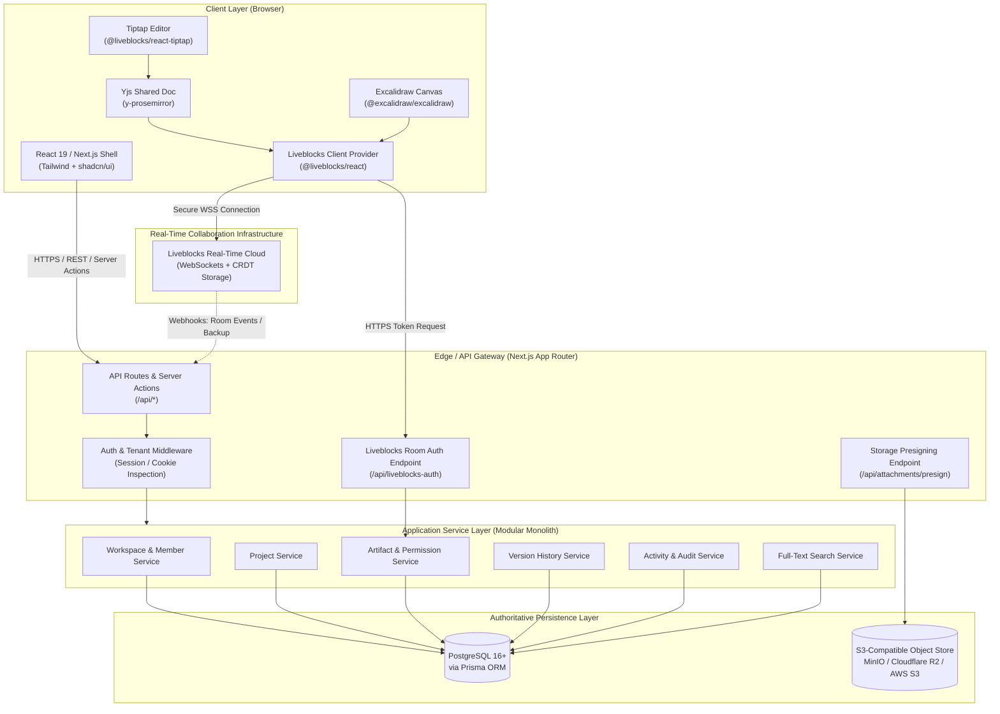

# SyncSpace — System Architecture

## 1. Architectural Principles & System Topology

SyncSpace is structured as a **modular monolith** built on the **Next.js App Router** framework. It deliberately avoids unnecessary distributed microservices while enforcing clean logical boundaries between domain modules, persistence layers, and real-time synchronization engines.

### System Topology Diagram



---

## 2. Component Boundaries & Responsibilities

### 2.1 Frontend Components
- **Workspace Shell**: Manages the overarching layout, responsive sidebar, breadcrumbs, search shortcut listener (`Cmd+K`), and notification bell.
- **Collaborative Editor (`<CollaborativeEditor />`)**:
  - Dynamically loaded client component.
  - Consumes `useLiveblocksExtension` from `@liveblocks/react-tiptap`.
  - Disables Tiptap's local undo manager in favor of Yjs collaboration undo/redo.
  - Renders floating bubble menus, slash command lists, and selection-anchored comment triggers.
- **Collaborative Whiteboard (`<CollaborativeWhiteboard />`)**:
  - Dynamically loaded client component (`next/dynamic` with `ssr: false`) to avoid SSR canvas initialization errors.
  - Subscribes to room elements via `useStorage((root) => root.elements)`.
  - Binds local canvas mutations via Excalidraw's `onChange` to Liveblocks mutations, gated by local version diffing to prevent feedback loops.
  - Merges incoming changes using Excalidraw’s official `reconcileElements` algorithm.
  - Maps Liveblocks presence (`useOthers`) to Excalidraw's `collaborators` state.
- **Presence Overlay & Avatars**:
  - Displays currently connected active collaborators with individual color coding and tooltips.

### 2.2 Server-Side Route Handlers & Server Actions
- **Authentication Routes (`/api/auth/[...all]`)**: Better Auth endpoint handler managing registration, password authentication, sessions, and OAuth callbacks.
- **Liveblocks Room Authorization (`/api/liveblocks-auth`)**: Validates that the active session user is authorized to read or write the requested room identifier, issuing a cryptographically signed Liveblocks room token.
- **Attachment Presign Routes (`/api/attachments/presign-upload`, `/api/attachments/presign-download`)**: Enforces file size limits, MIME type verification, and workspace access before generating signed S3 URLs.
- **Server Actions**: Strongly typed mutations for creating workspaces, updating projects, reordering artifacts, and changing member roles with automatic revalidation of Next.js tag caches.

### 2.3 Application Services Layer
Located in `@/services` to decouple HTTP transport from business logic:
- `WorkspaceService`: Tenant lifecycle, slug verification, workspace member enrollment, and role updates.
- `ArtifactService`: CRUD operations on documents and whiteboards, title updates, soft-deletion, and effective permission calculation (`resolveEffectivePermission`).
- `LiveblocksAuthService`: Encapsulates `@liveblocks/node` client; converts database roles (`OWNER`, `ADMIN`, `EDITOR`, `VIEWER`) into Liveblocks permission scopes (`["room:write"]` vs `["room:read"]`).
- `VersionService`: Manages periodic snapshot generation and rollbacks for documents and whiteboards in PostgreSQL `ArtifactVersion`.
- `StorageService`: Manages AWS S3 / MinIO client connections, signed URL generation, and lifecycle deletion of attachment assets.

---

## 3. Real-Time Architecture Deep Dive

### 3.1 Document Collaboration (Tiptap + Yjs + Liveblocks)

The document collaboration pipeline uses the official `@liveblocks/react-tiptap` integration:

1. **State Ownership**:
   - The authoritative real-time state of the document text resides in the **Liveblocks Cloud Room Storage** as a **Yjs Document (`Y.Doc`)**.
   - PostgreSQL does *not* receive keystroke-level updates. PostgreSQL stores metadata (title, updated timestamp, author) and periodic point-in-time snapshot blobs (`ArtifactVersion`).
2. **Editor Initialization**:
   - The client enters a Liveblocks room `<RoomProvider id={`artifact:${artifactId}`} initialStorage={{...}}>`.
   - The `<Editor />` component invokes `useLiveblocksExtension()` which binds to the active room's Yjs provider under the hood.
   - Tiptap is initialized with `StarterKit.configure({ history: false })` (local undo/redo is disabled).
   - If the remote Yjs document is empty, `initialContent` can hydrate the document without re-injecting duplicate paragraphs.
3. **Live Cursors & Presence**:
   - Managed automatically by `@liveblocks/react-tiptap` through Yjs awareness protocol mapped to Liveblocks presence.
   - Collaborators' names and assigned colors are passed during server token authorization in `userInfo`.
4. **Viewer-Only Enforcement**:
   - If a user's role is `VIEWER`, the Tiptap editor is initialized with `editable: false`.
   - On the server, `session.allow(`artifact:${artifactId}`, ["room:read"])` is granted without `room:write`.
5. **Reconnection & Offline Recovery**:
   - Yjs tracks state vectors. If network connectivity drops, local edits accumulate in the client's Yjs memory.
   - Upon reconnection to Liveblocks WebSockets, Yjs state vectors exchange diffs and converge deterministically.

---

### 3.2 Whiteboard Collaboration (Excalidraw + Liveblocks)

#### Option Evaluation

| Criterion | Option A: Standalone `excalidraw-room` (Socket.IO) | Option B: Liveblocks Storage + `reconcileElements` (Recommended) |
| :--- | :--- | :--- |
| **Architecture** | Requires running and maintaining a separate Node.js Socket.IO microservice | Integrated directly into existing Liveblocks real-time infrastructure; zero extra microservices |
| **Authentication & RBAC** | Completely unauthenticated by default; relies on room IDs in URL hash; no DB integration | Reuses `/api/liveblocks-auth`; strictly validates PostgreSQL workspace membership and artifact roles |
| **Concurrency & Conflicts** | Socket broadcast of encrypted chunks; naive merge prone to race conditions on simultaneous edits | Per-element CRDT tracking via `LiveMap<string, LiveObject<ExcalidrawElement>>` + monotonic `versionNonce` LWW reconciliation |
| **Presence & Cursors** | Ephemeral Socket.IO broadcasts | Liveblocks Presence (`useMyPresence`, `useOthers`) mapped directly to Excalidraw `collaborators` API |
| **Persistence & Reconnection**| Redis or ephemeral memory in separate service; requires custom backup pipelines | Native Liveblocks room storage persistence; automatic sync back to PostgreSQL snapshots |
| **Operational Overhead** | High (2nd cluster, WebSocket scaling, separate monitoring, separate SSL) | Minimal (Unified in Liveblocks SDK with existing document rooms) |

#### Recommended Implementation Details (Option B)

1. **Room Storage Schema**:
   The room storage holds:
   ```ts
   type WhiteboardStorage = {
     elements: LiveMap<string, LiveObject<ExcalidrawElement>>;
     appState: LiveObject<{
       viewBackgroundColor: string;
       gridSize: number | null;
     }>;
   };
   ```
2. **Local Change Capture (`onChange`)**:
   - When the user draws or moves elements, Excalidraw calls `onChange(elements, appState, files)`.
   - The wrapper component filters for elements whose `version` or `versionNonce` has changed compared to the last synced state.
   - It executes a Liveblocks `useMutation` updating only the modified elements in `storage.get("elements")`.
   - Deletions: Excalidraw marks deleted elements with `isDeleted: true`. The mutation updates the element with `isDeleted: true` so remote clients remove it via reconciliation, avoiding resurrection.
3. **Remote Update Reception & Reconciliation**:
   - The component subscribes to `useStorage((root) => root.elements)`.
   - When remote elements update, the component retrieves the local canvas state using `excalidrawAPI.getSceneElementsIncludingDeleted()`.
   - It runs `reconcileElements(localElements, remoteElementsArray, localAppState)`.
   - It updates the canvas via `excalidrawAPI.updateScene({ elements: reconciled })`.
   - **Loop Guard**: An `isRemoteUpdate` flag or version nonce equality check prevents the incoming update from re-triggering an outgoing mutation in `onChange`.
4. **Presence & Cursors**:
   - Pointer coordinates and selected element IDs are synced via `useMyPresence({ pointer: { x, y }, selectedElementIds })`.
   - Other users' presence from `useOthers()` is transformed into an Excalidraw `Collaborator` record and passed to `excalidrawAPI.updateScene({ collaborators })`.

---

## 4. Authoritative Data Ownership Matrix

To prevent duplicate sources of truth and state corruption, data ownership is strictly partitioned:

| Data Category | Authoritative Store | Secondary / Cached Stores | Sync Trigger & Mechanism |
| :--- | :--- | :--- | :--- |
| **User & Auth Records** | PostgreSQL (`User`, `Account`, `Session`, `Verification`) | Better Auth Session Cookie | On login / profile update |
| **Workspace & Roles** | PostgreSQL (`Workspace`, `WorkspaceMember`) | Next.js Server Components / React Query | On membership change |
| **Artifact Metadata** | PostgreSQL (`Artifact`, `Project`) | Next.js Page Props / UI state | On rename, move, pin, archive |
| **Document Content** | **Liveblocks Cloud (Yjs CRDT)** | PostgreSQL (`ArtifactVersion` snapshots) | Keystrokes via WebSockets; periodic snapshot to DB (on room idle or manual save) |
| **Whiteboard Scene** | **Liveblocks Cloud (`LiveMap`)** | PostgreSQL (`ArtifactVersion` snapshots) | Drawing actions via WebSockets; periodic snapshot to DB |
| **Live Cursors & Presence**| **Liveblocks Cloud (Ephemeral Presence)** | In-memory React Component state | Direct WebSocket ephemeral broadcast (never persisted to DB) |
| **Comments & Threads** | Liveblocks Comments Engine | PostgreSQL (optional reference index for search) | Liveblocks WebSockets & Webhooks |
| **File Attachments** | S3-Compatible Object Store | PostgreSQL (`Attachment` metadata table) | Presigned PUT upload completion |
| **Activity & Audit Events**| PostgreSQL (`ActivityEvent`) | Client Activity Stream UI | Append-only on domain mutations |

---

## 5. Transaction Boundaries & Error Propagation

### 5.1 Database Transactions (`prisma.$transaction`)
Transactions are strictly required for multi-table atomic operations:
1. **Workspace Creation**:
   - Insert `Workspace`
   - Insert `WorkspaceMember` (`role: OWNER`)
   - Insert default "General" `Project`
   - Insert starter "Welcome to SyncSpace" `Artifact`
   - Insert `ActivityEvent`
2. **Project Deletion with Cascade/Move**:
   - Relocate or archive child `Artifact` records
   - Delete `Project`
   - Insert `ActivityEvent`
3. **Artifact Duplication**:
   - Read source `Artifact`
   - Insert new `Artifact` with copied metadata
   - Copy `ArtifactVersion` records
   - If document or whiteboard, trigger server-to-server Liveblocks room clone or snapshot copy

### 5.2 Error Propagation Standard
- **Domain Errors**: Strongly typed subclasses of `AppError` (`NotFoundError`, `ForbiddenError`, `ConflictError`, `ValidationError`).
- **API Responses**: Return standard RFC 7807 Problem Details JSON format:
  ```json
  {
    "type": "https://syncspace.dev/errors/forbidden",
    "title": "Forbidden",
    "status": 403,
    "detail": "You do not have write permissions for this artifact.",
    "code": "ARTIFACT_READ_ONLY"
  }
  ```
- **Client Handling**: Unhandled exceptions are caught by Next.js `error.tsx` boundary with retry controls; form validation errors are rendered inline via `react-hook-form` + `zod`.
