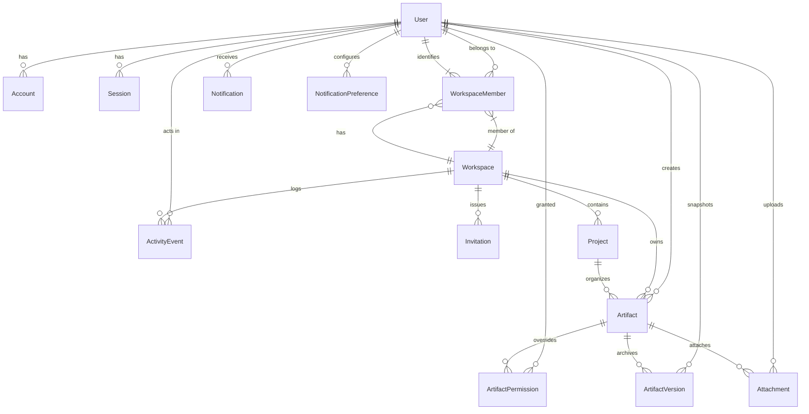

# SyncSpace — Data Model & Entity Specifications

## 1. Overview & Data Design Principles

SyncSpace relies on **PostgreSQL** as the single source of truth for identity, tenancy, workspaces, membership roles, project hierarchies, metadata, permissions, audit history, and file attachments. 

Content editing states (such as Yjs document trees and Excalidraw element maps) are managed in real time within Liveblocks room storage, while point-in-time snapshots and backup history are captured into the relational `ArtifactVersion` table.

---

## 2. Entity-Relationship Diagram



---

## 3. Detailed Entity Specifications

### 3.1 Authentication & Identity Entities

#### `User`
Primary user identity record.
- **Fields**:
  - `id`: `String` (cuid2 / uuidv7, Primary Key)
  - `email`: `String` (Unique, indexed)
  - `emailVerified`: `DateTime?`
  - `passwordHash`: `String?` (Null for pure OAuth users)
  - `name`: `String`
  - `avatarUrl`: `String?`
  - `color`: `String` (Hex color code assigned for live cursors and avatars, e.g. `#6366F1`)
  - `createdAt`: `DateTime` (Default: `now()`)
  - `updatedAt`: `DateTime` (Updated automatically)
- **Relationships**: One-to-many with `WorkspaceMember`, `Account`, `Session`, `Artifact`, `Attachment`, `ActivityEvent`.
- **Deletion Behavior**: Soft-delete flag or restricted cascade. If a user is deleted, their created artifacts remain intact with `createdById` preserved or reassigned to a designated workspace owner.

#### `Account`, `Session` & `Verification` (Better Auth Standard)
- Official Better Auth Prisma adapter entities mapping OAuth accounts (`accountId`, `providerId`, `userId`, `accessToken`, `refreshToken`, `password`), active database sessions (`token`, `userId`, `expiresAt`, `ipAddress`, `userAgent`), and email/phone verification records (`identifier`, `value`, `expiresAt`).

---

### 3.2 Tenancy, Workspaces & Membership

#### `Workspace`
The core organizational tenant.
- **Fields**:
  - `id`: `String` (Primary Key)
  - `name`: `String` (e.g. "Acme Product Team")
  - `slug`: `String` (Unique, indexed; URL-safe slug, e.g. "acme-product")
  - `logoUrl`: `String?`
  - `createdAt`: `DateTime` (Default: `now()`)
  - `updatedAt`: `DateTime`
- **Indexes**: `@@index([slug])`
- **Deletion Behavior**: Cascades to `WorkspaceMember`, `Invitation`, `Project`, `Artifact`, `ActivityEvent`.

#### `WorkspaceMember`
Associates users with workspaces and defines their role.
- **Fields**:
  - `id`: `String` (Primary Key)
  - `workspaceId`: `String` (Foreign Key -> `Workspace.id`)
  - `userId`: `String` (Foreign Key -> `User.id`)
  - `role`: `WorkspaceRole` (Enum: `OWNER`, `ADMIN`, `EDITOR`, `VIEWER`)
  - `joinedAt`: `DateTime` (Default: `now()`)
- **Constraints & Indexes**:
  - `@@unique([workspaceId, userId])`
  - `@@index([userId])`
  - `@@index([workspaceId, role])`
- **Deletion Behavior**: Cascades on `Workspace` or `User` deletion. Deleting a member immediately revokes workspace access.

#### `Invitation`
Pending email invitations to join a workspace.
- **Fields**:
  - `id`: `String` (Primary Key)
  - `workspaceId`: `String` (Foreign Key -> `Workspace.id`)
  - `email`: `String` (Recipient email)
  - `role`: `WorkspaceRole` (Default: `EDITOR`, restricted to `ADMIN`, `EDITOR`, `VIEWER`; never `OWNER`)
  - `token`: `String` (Unique SHA-256 hash of the 256-bit unguessable raw token for token hashing at rest; raw bearer tokens are never persisted)
  - `invitedById`: `String` (Foreign Key -> `User.id`)
  - `status`: `InvitationStatus` (Enum: `PENDING`, `ACCEPTED`, `REVOKED`, `EXPIRED`)
  - `expiresAt`: `DateTime` (Default: 7 days from creation)
  - `createdAt`: `DateTime` (Default: `now()`)
- **Constraints & Indexes**:
  - `@@unique([token])`
  - `@@index([workspaceId, email])`
  - `@@index([token, status])`
- **Deletion Behavior**: Cascade on `Workspace` deletion.


---

### 3.3 Projects & Unified Artifact Model

#### `Project`
Logical grouping within a workspace.
- **Fields**:
  - `id`: `String` (Primary Key)
  - `workspaceId`: `String` (Foreign Key -> `Workspace.id`)
  - `name`: `String` (e.g., "Mobile Redesign")
  - `description`: `String?`
  - `icon`: `String?` (Lucide icon identifier or emoji)
  - `color`: `String?`
  - `isArchived`: `Boolean` (Default: `false`)
  - `createdById`: `String` (Foreign Key -> `User.id`)
  - `createdAt`: `DateTime` (Default: `now()`)
  - `updatedAt`: `DateTime`
- **Indexes**:
  - `@@index([workspaceId, isArchived])`
  - `@@index([createdById])`
- **Deletion Behavior**: Restricted if artifacts exist, or triggers artifact migration to workspace root.

#### `Artifact`
Unified polymorphic model for both rich-text **Documents** and visual **Whiteboards**.
- **Fields**:
  - `id`: `String` (Primary Key)
  - `workspaceId`: `String` (Foreign Key -> `Workspace.id`)
  - `projectId`: `String?` (Foreign Key -> `Project.id`, optional)
  - `type`: `ArtifactType` (Enum: `DOCUMENT`, `WHITEBOARD`)
  - `title`: `String` (Default: "Untitled")
  - `description`: `String?`
  - `icon`: `String?`
  - `coverImageUrl`: `String?`
  - `liveblocksRoomId`: `String` (Unique, calculated or stored: `art_${id}`)
  - `isPinned`: `Boolean` (Default: `false`)
  - `isArchived`: `Boolean` (Default: `false`)
  - `createdById`: `String` (Foreign Key -> `User.id`)
  - `updatedById`: `String?` (Foreign Key -> `User.id`)
  - `createdAt`: `DateTime` (Default: `now()`)
  - `updatedAt`: `DateTime`
- **Constraints & Indexes**:
  - `@@unique([liveblocksRoomId])`
  - `@@index([workspaceId, projectId, isArchived])`
  - `@@index([workspaceId, type, updatedAt])`
  - `@@index([createdById])`
- **Deletion Behavior**: Soft-deletable (`isArchived: true`) or hard delete cascading to `ArtifactPermission`, `ArtifactVersion`, `Attachment`.

#### `ArtifactPermission`
Granular per-artifact access overrides that exceed or constrain workspace defaults.
- **Fields**:
  - `id`: `String` (Primary Key)
  - `artifactId`: `String` (Foreign Key -> `Artifact.id`)
  - `userId`: `String` (Foreign Key -> `User.id`)
  - `role`: `ArtifactRole` (Enum: `EDITOR`, `VIEWER`, `NONE`)
  - `createdAt`: `DateTime` (Default: `now()`)
- **Constraints & Indexes**:
  - `@@unique([artifactId, userId])`
  - `@@index([userId])`
- **Deletion Behavior**: Cascade on `Artifact` or `User` deletion.

---

### 3.4 Version History & Attachments

#### `ArtifactVersion`
Point-in-time snapshots for recovery and audit history.
- **Fields**:
  - `id`: `String` (Primary Key)
  - `artifactId`: `String` (Foreign Key -> `Artifact.id`)
  - `versionNumber`: `Int`
  - `title`: `String` (Snapshot of title at version time)
  - `snapshotData`: `Json` (Full JSON serialization of Tiptap document or Excalidraw scene elements)
  - `changeSummary`: `String?` (e.g. "Auto-saved snapshot", "Major rewrite of Section 3")
  - `createdById`: `String` (Foreign Key -> `User.id`)
  - `createdAt`: `DateTime` (Default: `now()`)
- **Constraints & Indexes**:
  - `@@unique([artifactId, versionNumber])`
  - `@@index([artifactId, createdAt])`
- **Deletion Behavior**: Cascade on `Artifact` deletion.

#### `Attachment`
Uploaded media and files attached to documents or whiteboards.
- **Fields**:
  - `id`: `String` (Primary Key)
  - `workspaceId`: `String` (Foreign Key -> `Workspace.id`)
  - `artifactId`: `String` (Foreign Key -> `Artifact.id`)
  - `fileName`: `String`
  - `fileKey`: `String` (S3 object key: `workspaces/${wsId}/artifacts/${artId}/${fileId}-${fileName}`)
  - `fileSize`: `Int` (Bytes)
  - `mimeType`: `String`
  - `uploadedById`: `String` (Foreign Key -> `User.id`)
  - `createdAt`: `DateTime` (Default: `now()`)
- **Constraints & Indexes**:
  - `@@index([artifactId])`
  - `@@index([workspaceId])`
- **Deletion Behavior**: S3 object must be deleted when record is purged.

---

### 3.5 Activity & Notifications

#### `ActivityEvent`
Workspace-level audit log.
- **Fields**:
  - `id`: `String` (Primary Key)
  - `workspaceId`: `String` (Foreign Key -> `Workspace.id`)
  - `actorId`: `String` (Foreign Key -> `User.id`)
  - `entityType`: `String` ("ARTIFACT", "PROJECT", "MEMBER", "WORKSPACE")
  - `entityId`: `String`
  - `action`: `String` ("CREATED", "UPDATED", "ARCHIVED", "DELETED", "ROLE_CHANGED")
  - `metadata`: `Json?`
  - `createdAt`: `DateTime` (Default: `now()`)
- **Indexes**: `@@index([workspaceId, createdAt])`

#### `Notification` & `NotificationPreference`
- **Notification**: Stores in-app alerts (`id`, `userId`, `workspaceId`, `type`, `title`, `message`, `linkUrl`, `readAt`, `createdAt`).
- **NotificationPreference**: User preferences for email and in-app channels (`userId`, `emailMentions`, `emailReplies`, `emailInvites`).

---

## 4. Effective Access Resolution Logic

When an authenticated user requests access to an artifact (via web UI, API, or Liveblocks room authorization), the server evaluates effective permissions using the following deterministic precedence:

```typescript
export type EffectiveRole = "OWNER" | "ADMIN" | "EDITOR" | "VIEWER" | "DENIED";

export async function resolveEffectivePermission(
  userId: string,
  artifactId: string
): Promise<EffectiveRole> {
  // 1. Fetch artifact and user's workspace membership
  const artifact = await prisma.artifact.findUnique({
    where: { id: artifactId },
    select: {
      workspaceId: true,
      createdById: true,
      isArchived: true,
    },
  });

  if (!artifact || artifact.isArchived) return "DENIED";

  const member = await prisma.workspaceMember.findUnique({
    where: {
      workspaceId_userId: {
        workspaceId: artifact.workspaceId,
        userId: userId,
      },
    },
  });

  if (!member) return "DENIED";

  // 2. Owners and Admins always have full administrative permissions
  if (member.role === "OWNER") return "OWNER";
  if (member.role === "ADMIN") return "ADMIN";

  // 3. Check for specific ArtifactPermission override
  const override = await prisma.artifactPermission.findUnique({
    where: {
      artifactId_userId: {
        artifactId: artifactId,
        userId: userId,
      },
    },
  });

  if (override) {
    if (override.role === "NONE") return "DENIED";
    if (override.role === "EDITOR") return "EDITOR";
    if (override.role === "VIEWER") return "VIEWER";
  }

  // 4. Fallback to general workspace membership role
  if (member.role === "EDITOR") return "EDITOR";
  if (member.role === "VIEWER") return "VIEWER";

  return "DENIED";
}
```

### Liveblocks Scope Translation
- `OWNER`, `ADMIN`, `EDITOR`: `session.allow(room, ["room:write"])`
- `VIEWER`: `session.allow(room, ["room:read", "room:presence:write"])`
- `DENIED`: Request rejected with HTTP 403 Forbidden.
