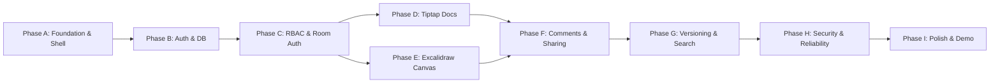

# SyncSpace — Implementation Roadmap & Milestones

## Overview & Execution Strategy

The implementation of SyncSpace is structured into nine sequential, dependency-aware phases (Phase A through Phase I). Each phase delivers verified, functional capabilities without placeholder mock implementations.

---

## Phase A: Foundation & UI Shell

- **Prerequisites**: Node.js v24.x environment, empty workspace at `d:\syncspace`.
- **Deliverables**:
  - Initialized Next.js App Router application with strict TypeScript, Tailwind CSS, and shadcn/ui.
  - Design token system (colors, typography, radii, dark/light theme provider).
  - Main responsive application shell (collapsible sidebar, breadcrumb bar, user menu, navigation links).
  - Vitest and Playwright configuration.
- **Expected Files / Modules**:
  - `package.json`, `tsconfig.json`, `tailwind.config.ts`, `components.json`
  - `app/layout.tsx`, `app/globals.css`, `components/theme-provider.tsx`
  - `components/layout/sidebar.tsx`, `components/layout/header.tsx`, `components/layout/breadcrumbs.tsx`
  - `vitest.config.ts`, `playwright.config.ts`
- **Acceptance Criteria**:
  - Application builds clean with `npm run build` with zero TypeScript or ESLint errors.
  - Dark mode and light mode toggle smoothly without flicker.
  - Sidebar expands and collapses with persisted state.
- **Automated Tests**:
  - Unit tests verifying theme switching and layout rendering.
- **External Dependencies**: None.
- **Definition of Done**: Base shell loads, responsive on mobile and desktop, ready for routing and database bindings.

---

## Phase B: Authentication, Database & Workspace Management

- **Prerequisites**: Phase A complete, local PostgreSQL connection string.
- **Deliverables**:
  - Prisma schema with `User`, `Account`, `Session`, `Verification`, `Workspace`, `WorkspaceMember`, and `Project`.
  - Database schema generated and migration ready.
  - Better Auth setup (email/password credentials, session handling, Prisma adapter).
  - Onboarding wizard and workspace creation flow.
  - Workspace switcher and project CRUD operations.
- **Expected Files / Modules**:
  - `prisma/schema.prisma`, `prisma.config.ts`, `src/lib/prisma.ts`
  - `src/lib/auth.ts`, `src/lib/auth-client.ts`, `src/app/api/auth/[...all]/route.ts`
  - `src/services/workspace.service.ts`, `src/services/project.service.ts`, `src/services/authorization.service.ts`
  - `src/app/login/page.tsx`, `src/app/register/page.tsx`
  - `app/(app)/[workspaceSlug]/dashboard/page.tsx`, `app/(app)/[workspaceSlug]/projects/page.tsx`
- **Acceptance Criteria**:
  - Users can register, log in, create a workspace, and switch between workspaces.
  - All workspace queries are scoped to the active tenant.
  - Seed script seeds synthetic test users and workspaces.
- **Automated Tests**:
  - Vitest unit tests for user hashing and workspace slug generator.
  - Integration tests for `WorkspaceService` and `ProjectService` CRUD.
- **External Dependencies**: Local PostgreSQL instance.
- **Definition of Done**: Multi-workspace tenancy functional with authenticated sessions and project management.

---

## Phase C: Authorization, Invitations & Collaboration-Room Access

- **Prerequisites**: Phase B complete.
- **Deliverables**:
  - Role-based access control (RBAC) helpers (`resolveEffectivePermission`).
  - Workspace member management and role promotion/demotion.
  - Cryptographic invitation generation, email link acceptance flow, and invite expiry.
  - Liveblocks server-side authorization endpoint (`/api/liveblocks-auth`) enforcing artifact permissions.
- **Expected Files / Modules**:
  - `lib/permissions.ts`, `services/invitation.service.ts`, `services/member.service.ts`
  - `app/api/liveblocks-auth/route.ts`, `app/(app)/[workspaceSlug]/settings/members/page.tsx`
  - `app/invite/[token]/page.tsx`
- **Acceptance Criteria**:
  - Supplying an unauthorized room ID to `/api/liveblocks-auth` returns HTTP 403.
  - Editor role receives `room:write`; Viewer role receives `room:read`.
  - Revoking membership prevents subsequent room token renewals.
- **Automated Tests**:
  - Unit tests for `resolveEffectivePermission` edge cases.
  - Route tests for `/api/liveblocks-auth` with mock sessions.
- **External Dependencies**: Liveblocks secret key (`LIVEBLOCKS_SECRET_KEY`).
- **Definition of Done**: Room tokens are securely minted strictly upon PostgreSQL authorization validation.

---

## Phase D: Tiptap Documents with Genuine Real-Time Editing

- **Prerequisites**: Phase C complete.
- **Deliverables**:
  - Rich-text document editor powered by Tiptap v2 and `@liveblocks/react-tiptap`.
  - Slash command menu (`/` trigger) and floating format toolbar.
  - Real-time multiplayer synchronization via Yjs.
  - Live collaborator presence and cursor overlays with assigned user colors.
  - Read-only enforcement for `VIEWER` roles.
  - Automatic snapshot persistence to PostgreSQL `ArtifactVersion`.
- **Expected Files / Modules**:
  - `features/documents/components/document-editor.tsx`
  - `features/documents/components/floating-menu.tsx`, `features/documents/components/slash-command.tsx`
  - `features/documents/extensions/*`, `features/documents/hooks/use-document-sync.ts`
  - `app/(app)/[workspaceSlug]/docs/[artifactId]/page.tsx`
- **Acceptance Criteria**:
  - Multiple browsers typing concurrently converge without lost keystrokes.
  - Viewer role cannot edit or trigger slash commands.
  - Refreshing the browser reloads the exact latest collaborative document state.
- **Automated Tests**:
  - Unit tests for document serialization and slash command filtering.
  - Playwright multi-context test with two concurrent editors typing in parallel.
- **External Dependencies**: Liveblocks public and secret keys.
- **Definition of Done**: Real-time collaborative document editing fully functional and verified across concurrent sessions.

---

## Phase E: Excalidraw Integration & Genuine Synchronized Whiteboards

- **Prerequisites**: Phase C complete.
- **Deliverables**:
  - Collaborative whiteboard powered by `@excalidraw/excalidraw` and Liveblocks `LiveMap`.
  - Granular per-element synchronization using `reconcileElements`.
  - Collaborator presence and cursor synchronization via `collaborators` API.
  - Read-only view mode for `VIEWER` users.
  - PNG, SVG, and JSON scene export.
  - Whiteboard snapshot persistence to PostgreSQL `ArtifactVersion`.
- **Expected Files / Modules**:
  - `features/whiteboards/components/whiteboard-canvas.tsx`
  - `features/whiteboards/components/collaborative-excalidraw.tsx`
  - `features/whiteboards/hooks/use-whiteboard-sync.ts`
  - `features/whiteboards/utils/reconciliation.ts`
  - `app/(app)/[workspaceSlug]/boards/[artifactId]/page.tsx`
- **Acceptance Criteria**:
  - Shapes drawn on Browser 1 appear on Browser 2 in real time (<100ms).
  - Simultaneous movements of distinct shapes merge without rollbacks or conflicts.
  - Deleted shapes propagate tombstones correctly without resurrection.
  - Canvas exports to PNG and SVG cleanly.
- **Automated Tests**:
  - Unit tests for Excalidraw element diffing and reconciliation wrappers.
  - Playwright test simulating two users creating shapes simultaneously.
- **External Dependencies**: Liveblocks keys.
- **Definition of Done**: Multi-user whiteboard editing completely operational with genuine CRDT/reconciliation sync.

---

## Phase F: Comments, Mentions, Notifications & Sharing

- **Prerequisites**: Phase D and Phase E complete.
- **Deliverables**:
  - Selection-anchored comments in Tiptap documents using Liveblocks threads.
  - Sticky notes and contextual comment pins on Excalidraw boards.
  - Inline `@mention` user autocomplete and notification trigger.
  - In-app notification center inbox with unread counts and direct artifact deep-links.
  - Artifact sharing modal with user-specific permission overrides.
- **Expected Files / Modules**:
  - `features/comments/components/comment-thread.tsx`, `features/comments/components/comment-panel.tsx`
  - `features/notifications/components/notifications-popover.tsx`
  - `features/sharing/components/share-dialog.tsx`
  - `app/api/users/mention-suggestions/route.ts`
- **Acceptance Criteria**:
  - Leaving a comment on highlighted text pins the thread to the document range.
  - Mentioning a user triggers an in-app notification for that user.
  - Sharing an artifact with a user as `VIEWER` restricts their room token to read-only.
- **Automated Tests**:
  - Integration test for mention suggestion search and permission overrides.
- **External Dependencies**: Liveblocks comments infrastructure.
- **Definition of Done**: Threaded discussions, mentions, notifications, and sharing dialogs work seamlessly across documents and whiteboards.

---

## Phase G: Version History, Attachments, Search & Activity

- **Prerequisites**: Phase F complete.
- **Deliverables**:
  - S3-compatible private file attachment service with presigned upload and download URLs.
  - File upload drawer with drag-and-drop preview.
  - Point-in-time version history viewer with one-click snapshot rollback.
  - Full-text search and global command palette (`Cmd+K`).
  - Workspace-wide activity feed.
- **Expected Files / Modules**:
  - `services/storage.service.ts`, `app/api/attachments/presign-upload/route.ts`, `app/api/attachments/presign-download/route.ts`
  - `features/attachments/components/attachment-drawer.tsx`
  - `features/history/components/version-history-panel.tsx`
  - `features/search/components/command-palette.tsx`
  - `features/activity/components/activity-feed.tsx`
- **Acceptance Criteria**:
  - Files up to 25MB upload directly to S3 via presigned URLs and render download links.
  - Reverting a version restores the exact previous document/board snapshot.
  - `Cmd+K` finds documents, whiteboards, and projects instantly by title or content.
- **Automated Tests**:
  - Unit tests for S3 key formatting and command palette search indexing.
- **External Dependencies**: S3 bucket or MinIO.
- **Definition of Done**: Attachments, version history, search, and activity tracking fully verified.

---

## Phase H: Security Review, Automated Testing & Reliability

- **Prerequisites**: Phase G complete.
- **Deliverables**:
  - End-to-end multi-user Playwright suite testing concurrent documents, whiteboards, and permissions.
  - Vitest unit and integration test suite with high coverage across services.
  - Security audit: IDOR verification, room auth brute-force protection, rate limiting, and XSS sanitization checks.
  - Reconnection resilience tests (network simulation drop and reconnect).
- **Expected Files / Modules**:
  - `tests/e2e/collaboration.spec.ts`, `tests/e2e/permissions.spec.ts`, `tests/e2e/reconnection.spec.ts`
  - `tests/unit/permissions.test.ts`, `tests/integration/artifacts.test.ts`
  - `middleware/rate-limiter.ts`
- **Acceptance Criteria**:
  - All unit, integration, and E2E Playwright tests pass without flakes.
  - Zero unhandled security exceptions or IDOR leaks.
- **Definition of Done**: Full test suite passes; production reliability standards proven.

---

## Phase I: UI Polish, Deployment, Documentation & Demo

- **Prerequisites**: Phase H complete.
- **Deliverables**:
  - Micro-interactions, loading skeletons, empty states, and toast notifications.
  - Seed script with realistic demo scenarios (architecture diagram, technical spec, team workspace).
  - Production build audit (`npm run build`).
  - Environment variable documentation (`.env.example`) and deployment guide.
  - Interactive demo walkthrough script.
- **Acceptance Criteria**:
  - Zero layout shift, flawless theme transitions, accessible keyboard focus rings.
  - Production build completes cleanly with optimal bundle sizes.
- **Definition of Done**: Complete, polished, production-ready collaborative workspace product.
