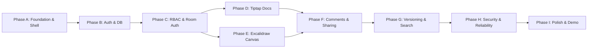

# SyncSpace — Implementation Roadmap & Milestones

## Overview & Execution Strategy

The implementation of SyncSpace is structured into nine sequential, dependency-aware phases (Phase A through Phase I). Each phase delivers verified, functional capabilities without placeholder mock implementations.

---

## Phase A: Foundation & UI Shell

- **Prerequisites**: Node.js v24.x environment, empty workspace at `d:\syncspace`.
- **Deliverables**:
  - Initialized Next.js App Router application with strict TypeScript, Tailwind CSS, and shadcn/ui.
  - Design token system (colors, typography, radii, dark/light theme provider).
  - Main responsive application shell (collapsible sidebar, breadcrumb bar, user menu, navigation links).
  - Vitest and Playwright configuration.
- **Expected Files / Modules**:
  - `package.json`, `tsconfig.json`, `tailwind.config.ts`, `components.json`
  - `app/layout.tsx`, `app/globals.css`, `components/theme-provider.tsx`
  - `components/layout/sidebar.tsx`, `components/layout/header.tsx`, `components/layout/breadcrumbs.tsx`
  - `vitest.config.ts`, `playwright.config.ts`
- **Acceptance Criteria**:
  - Application builds clean with `npm run build` with zero TypeScript or ESLint errors.
  - Dark mode and light mode toggle smoothly without flicker.
  - Sidebar expands and collapses with persisted state.
- **Automated Tests**:
  - Unit tests verifying theme switching and layout rendering.
- **External Dependencies**: None.
- **Definition of Done**: Base shell loads, responsive on mobile and desktop, ready for routing and database bindings.

---

## Phase B: Authentication, Database & Workspace Management

- **Prerequisites**: Phase A complete, local PostgreSQL connection string.
- **Deliverables**:
  - Prisma schema with `User`, `Account`, `Session`, `Verification`, `Workspace`, `WorkspaceMember`, and `Project`.
  - Database schema generated and migration ready.
  - Better Auth setup (email/password credentials, session handling, Prisma adapter).
  - Onboarding wizard and workspace creation flow.
  - Workspace switcher and project CRUD operations.
- **Expected Files / Modules**:
  - `prisma/schema.prisma`, `prisma.config.ts`, `src/lib/prisma.ts`
  - `src/lib/auth.ts`, `src/lib/auth-client.ts`, `src/app/api/auth/[...all]/route.ts`
  - `src/services/workspace.service.ts`, `src/services/project.service.ts`, `src/services/authorization.service.ts`
  - `src/app/login/page.tsx`, `src/app/register/page.tsx`
  - `app/(app)/[workspaceSlug]/dashboard/page.tsx`, `app/(app)/[workspaceSlug]/projects/page.tsx`
- **Acceptance Criteria**:
  - Users can register, log in, create a workspace, and switch between workspaces.
  - All workspace queries are scoped to the active tenant.
  - Seed script seeds synthetic test users and workspaces.
- **Automated Tests**:
  - Vitest unit tests for user hashing and workspace slug generator.
  - Integration tests for `WorkspaceService` and `ProjectService` CRUD.
- **External Dependencies**: Local PostgreSQL instance.
- **Definition of Done**: Multi-workspace tenancy functional with authenticated sessions and project management.

---

## Phase C: Authorization, Invitations & Collaboration-Room Access (Implemented in Phase 4B & Phase 5)

- **Prerequisites**: Phase B complete.
- **Deliverables**:
  - Role-based access control (RBAC) helpers (`AuthorizationService.requireWorkspaceAccess`, `requireProjectAccess`, `requireArtifactAccess`, `requireArtifactRoomAccess`).
  - Per-artifact permission overrides (`ArtifactPermission` with `EDITOR`, `VIEWER`, `NONE` precedence over workspace roles).
  - Liveblocks server-side authorization endpoint (`POST /api/liveblocks-auth` and `LiveblocksAuthService`).
- **Implemented Files / Modules**:
  - `src/services/authorization.service.ts`, `src/services/liveblocks-auth.service.ts`, `src/services/artifact.service.ts`
  - `src/app/api/liveblocks-auth/route.ts`, `src/app/api/artifacts/[artifactId]/permissions/route.ts`
- **Acceptance Criteria**:
  - Supplying an unauthorized or revoked room ID to `/api/liveblocks-auth` returns HTTP 403.
  - Effective `OWNER`/`ADMIN`/`EDITOR` role receives `["*:write"]`; effective `VIEWER` role receives `["*:read"]`.
- **Automated Tests**:
  - `tests/unit/authorization.test.ts` and `tests/integration/liveblocks-auth.test.ts`.
- **External Dependencies**: Liveblocks secret key (`LIVEBLOCKS_SECRET_KEY`).

---

## Phase D: Tiptap Documents with Genuine Real-Time Editing (Implemented in Phase 5)

- **Prerequisites**: Phase C complete.
- **Deliverables**:
  - Rich-text document editor powered by Tiptap v3 (`@tiptap/react@3.32.0`), `yjs@13.6.29`, and `@liveblocks/react-tiptap@3.24.3`.
  - Slash command menu (`/` trigger), formatting toolbar, safe link popover (`http:`, `https:`, `mailto:`), resizable tables, task lists, and dynamic Document Outline.
  - Real-time multiplayer synchronization via Yjs CRDTs (`StarterKit.configure({ undoRedo: false })`).
  - Live collaborator presence avatars and cursor carets with assigned user colors.
  - Read-only enforcement (`editable: false`) for `VIEWER` roles and constrained artifact overrides.
  - Automatic debounced snapshot persistence to PostgreSQL `ArtifactVersion`.
- **Implemented Files / Modules**:
  - `src/components/documents/collaborative-editor.tsx`
  - `src/components/documents/editor-extensions.ts`
  - `src/components/documents/documents-directory.tsx`
  - `src/app/app/documents/[documentId]/page.tsx`, `src/app/app/documents/page.tsx`
- **Acceptance Criteria**:
  - Rich-text editing, title updates, slash commands, tables, outline, and snapshots persist in PostgreSQL.
  - Viewer role cannot edit or trigger slash commands.
  - External Liveblocks cloud multi-user WebSocket sync activates automatically when a non-placeholder `LIVEBLOCKS_SECRET_KEY` (`sk_...`) is configured in `.env`.
- **Phase 5B Verified Status (Liveblocks Cloud Real-Time Collaboration)**:
  - **Live WebSocket Synchronization**: User A and User B concurrently connect to the Liveblocks room via WebSocket without page reload. User A types -> User B observes updates live in real-time. User B replies -> User A observes updates live.
  - **Conflict-Free Concurrent Edits**: Rapid interleaved updates from multiple users merge deterministically via Yjs CRDTs without loss or overwrites.
  - **Live Presence & Indicators**: Online collaborator avatars display active peers in `[data-testid="collaborator-avatars"]` with deterministic user presence colors.
  - **Snapshot & Reload Persistence**: Document updates persist across full browser reloads and save to PostgreSQL `ArtifactVersion` via debounced snapshots.
  - **Strict Security & RBAC**: `VIEWER` members are enforced read-only in the live room (`contenteditable="false"`, disabled toolbar, API mutations blocked 403). Unauthorized users (outsiders not belonging to the workspace) are completely rejected from minting Liveblocks tokens (`/api/liveblocks-auth` 403) and denied document access.
  - **Secret Key Hygiene**: `LIVEBLOCKS_SECRET_KEY` is loaded strictly on the server, excluded from Git via `.gitignore`, never exposed to the client bundle or browser, and never logged.
- **Automated Verification**:
  - `npm.cmd run test:integration` (2 files, 5 passed)
  - `npm.cmd run test` (6 files, 33 passed)
  - `npm.cmd run lint` (0 warnings, 0 errors)
  - `npx.cmd tsc --noEmit` (0 errors)
  - `npm.cmd run build` (18/18 routes compiled)
  - `npx.cmd playwright test` (11/11 passed across UI shell, PostgreSQL auth/workspaces, and collaborative documents)

---

## Phase E: Excalidraw Integration & Genuine Synchronized Whiteboards

- **Prerequisites**: Phase C complete.
- **Deliverables**:
  - Collaborative whiteboard powered by `@excalidraw/excalidraw` and Liveblocks `LiveMap`.
  - Granular per-element synchronization using `reconcileElements`.
  - Collaborator presence and cursor synchronization via `collaborators` API.
  - Read-only view mode for `VIEWER` users.
  - PNG, SVG, and JSON scene export.
  - Whiteboard snapshot persistence to PostgreSQL `ArtifactVersion`.
- **Expected Files / Modules**:
  - `features/whiteboards/components/whiteboard-canvas.tsx`
  - `features/whiteboards/components/collaborative-excalidraw.tsx`
  - `features/whiteboards/hooks/use-whiteboard-sync.ts`
  - `features/whiteboards/utils/reconciliation.ts`
  - `app/(app)/[workspaceSlug]/boards/[artifactId]/page.tsx`
- **Acceptance Criteria**:
  - Shapes drawn on Browser 1 appear on Browser 2 in real time (<100ms).
  - Simultaneous movements of distinct shapes merge without rollbacks or conflicts.
  - Deleted shapes propagate tombstones correctly without resurrection.
  - Canvas exports to PNG and SVG cleanly.
- **Automated Tests**:
  - Unit tests for Excalidraw element diffing and reconciliation wrappers.
  - Playwright test simulating two users creating shapes simultaneously.
- **External Dependencies**: Liveblocks keys.
- **Definition of Done**: Multi-user whiteboard editing completely operational with genuine CRDT/reconciliation sync.
- **Phase 6 Verified Status (Excalidraw & Liveblocks Collaborative Whiteboards)**:
  - **Live WebSocket Element Synchronization**: Users concurrently connect to Liveblocks room storage (`LiveMap<string, ExcalidrawElement>`). User A draws shapes (rectangles) -> User B observes shapes live without page reload. User B connects arrows -> User A observes updates live.
  - **Granular LWW Reconciliation & Tombstones**: `reconcileElements` merges local canvas state with remote element updates without whole-canvas replacement. Deletions apply tombstone dominance (`isDeleted: true`, incremented version) preventing element resurrection.
  - **Feedback Loop Elimination**: Bidirectional synchronization prevents infinite loops via `isApplyingRemoteUpdateRef` suppression and element version tracking (`lastSyncedVersionsRef`).
  - **Ephemeral Presence & Collaborator Avatars**: Active remote peers are tracked via Liveblocks presence (`useMyPresence`, `useOthers`) and displayed as live collaborator badges with custom presence colors.
  - **Dual-Tier Persistence**: Active rooms persist in Liveblocks Cloud storage; debounced background saves (1500ms) persist non-deleted scene snapshots (`{ elements: ... }`) into PostgreSQL `ArtifactVersion` records.
  - **Role-Based Access Control & Security**: `VIEWER` users are enforced read-only (`viewModeEnabled={true}` in Excalidraw, `initialStorage` mutation suppression, `canEdit: false`, read-only UI banner). Non-workspace members (outsiders) receive 403 Forbidden on `/api/liveblocks-auth` and 404 Not Found on direct route access.
  - **Multi-Format Export**: Client-only dynamic export helpers support PNG, SVG, and JSON scene downloads without SSR window errors.
- **Automated Verification**:
  - `npm.cmd run test:integration` (2 files, 5 passed)
  - `npm.cmd run test` (7 files, 42 passed)
  - `npm.cmd run lint` (0 errors)
  - `npx.cmd tsc --noEmit` (0 errors)
  - `npm.cmd run build` (18/18 routes compiled, client chunks optimized)
  - `npx.cmd playwright test tests/e2e/collaborative-whiteboards.spec.ts` (2/2 passed)
  - `npx.cmd playwright test tests/e2e/collaborative-documents.spec.ts` (2/2 passed - Phase 5B regression verified clean)
  - `npx.cmd playwright test tests/e2e/auth-and-workspaces.spec.ts` (2/2 passed - Phase 4B regression verified clean)

---

## Phase F: Access Management, Invitations, Sharing, Comments & Notifications

### Phase 7A: Sharing, Invitations and Access Management (Completed & Verified)

- **Prerequisites**: Phase D and Phase E complete.
- **Deliverables**:
  - Cryptographically secure 256-bit workspace invitation tokens with SHA-256 digest hashing at rest in PostgreSQL.
  - Complete invitation lifecycle (`createInvitation`, `validateInvitationToken`, `acceptInvitation`, `declineInvitation`, `revokeInvitation`, `resendInvitation`).
  - Strict recipient email normalization, 7-day expiration, and authenticated session matching.
  - Role escalation prevention: `ADMIN` can invite only `EDITOR` or `VIEWER`; `OWNER` cannot be invited; `ADMIN` cannot remove/demote other `ADMIN` or `OWNER`.
  - Last-owner demotion and removal protection across workspace members.
  - Transparent "Secure Copyable Link Mode" UI preventing misleading email delivery promises.
  - Member management UI (`/app/members`) with role changing, pending invite revoke/resend, and member removal dialog.
  - Token redemption UI (`/app/invitations/[token]`) and redirect route (`/invite/[token]`).
  - Granular per-artifact permission overrides (`ArtifactPermission` with `EDITOR`, `VIEWER`, `NONE`, `INHERIT`) with full Liveblocks room token restriction and read-only banner enforcement.
- **Automated Verification**:
  - `npm.cmd run test:integration` (3 files, 12 passed, 0 skipped, 0 failed)
  - `npm.cmd run test` (8 files, 58 passed, 0 failed)
  - `npm.cmd run lint` (0 errors, 0 warnings)
  - `npx.cmd tsc --noEmit` (0 errors)
  - `npm.cmd run build` (18/18 routes compiled clean)
  - `npx.cmd playwright test tests/e2e/invitations-and-sharing.spec.ts` (2/2 passed)
  - Playwright regression suite: `collaborative-whiteboards` (2/2 passed), `collaborative-documents` (2/2 passed), `auth-and-workspaces` (2/2 passed).

### Phase 8A: Artifact Comments, Discussion Threads & Hardening (Completed & Verified)

- **Prerequisites**: Phase 7A complete.
- **Deliverables**:
  - Normalized relational data architecture (`CommentThread`, `Comment`, `CommentReaction`, and `CommentThreadEvent` models in PostgreSQL with Prisma 7).
  - Migrations `20261016131803_add_artifact_comments` and `20261016145124_add_comment_thread_events` applied cleanly to PostgreSQL.
  - Complete backend service layer (`CommentService`) covering thread creation, replies, editing, deletion with moderator support, resolving/reopening lifecycle, atomic resolution history logging, bounded cursor-based pagination, and concurrency-safe reaction toggling with atomic duplicate prevention.
  - Separate cursor pagination for thread replies (`listReplies`), preserving the root comment bound to the thread header.
  - Immutable state transition audit history (`CommentThreadEvent`) preserving previous records across resolve/reopen transitions with idempotence.
  - RESTful API endpoints at `/api/artifacts/[artifactId]/comments/*` (canonicalized under `threads/[threadId]/...`) with strict workspace tenancy and artifact-level access control (`AuthorizationService.requireArtifactAccess`).
  - Strict input validation via Zod schemas (`src/lib/validations/comment.ts`) enforcing max 5,000 characters, typed anchor data validation (`GENERAL`, `TEXT_SELECTION`, `CANVAS_ELEMENT`, `CANVAS_COORDINATE`), and max 10KB payloads.
  - Outgoing DTO privacy: user email addresses strictly omitted to prevent PII leakage.
  - IDOR security defense returning 404 for non-members and 403 for revoked `NONE` overrides.
  - Universal responsive discussion panel (`ArtifactDiscussionPanel`) integrated into both collaborative documents (`/app/documents/[documentId]`) and collaborative whiteboards (`/app/whiteboards/[boardId]`).
  - Tab filtering (Open / Resolved / All), thread resolution, inline reply composer, emoji reaction pills and quick-picker, author-only edit dialog, delete confirmation modal, cursor-based "Load more discussions" and "Load more replies" buttons, and expandable resolution audit history drawer.
- **Automated Verification**:
  - `npm.cmd run test:integration` (4 files, 24 passed, 0 failed, includes 12 dedicated database integration tests in `comments.test.ts`)
  - `npm.cmd run test` (9 files, 70 passed, 0 failed)
  - `npm.cmd run lint` (0 errors, 0 warnings)
  - `npx.cmd tsc --noEmit` (0 errors)
  - `npm.cmd run build` (18/18 routes compiled clean, all canonical comment API endpoints generated)
  - `npx.cmd playwright test tests/e2e/artifact-comments.spec.ts` (2/2 passed)
  - Full Playwright regression suite: `npx.cmd playwright test` (17/17 passed across all 5 e2e specs).

### Phase 8B: Mentions & Notification Delivery (Completed & Verified)

- **Prerequisites**: Phase 8A complete.
- **Deliverables**:
  - Inline `@mention` user autocomplete suggestions during comment composition (`/api/artifacts/[artifactId]/mention-suggestions`).
  - Atomic mention extraction and RBAC-verified notification delivery (`NotificationService`).
  - In-app notification center inbox (`NotificationsPopover`) with unread counts, single/bulk mark-as-read, and direct artifact discussion deep-links.

---

## Phase G: Version History, Attachments, Search & Activity (Completed & Verified)

- **Prerequisites**: Phase F complete.
- **Deliverables**:
  - **Phase 9A — Point-in-Time Version History & Rollback**:
    - Immutable `ArtifactVersion` checkpoints (`MANUAL`, `AUTOMATIC`, `RESTORE_RECOVERY`, `RESTORED`) with monotonic version numbering, optimistic concurrency (`expectedRevision`), and live Tiptap/Excalidraw collaboration room synchronization (`VersionService`, `VersionHistoryPanel`).
  - **Phase 9B — Secure File Attachments**:
    - Staging-to-final private object storage promotion (`S3StorageProvider`, `LocalFileStorageProvider`, `InMemoryStorageProvider`), magic-byte content signature validation, SHA-256 integrity verification, and permission-scoped download/preview (`AttachmentService`, `ArtifactAttachmentsDrawer`).
  - **Phase 10A — Full-Text Search & Global Command Palette**:
    - PostgreSQL weighted `tsvector` + GIN full-text search across Documents, Whiteboards, and Projects with prefix matching, safe highlighted excerpts, and strict RBAC filtering (`SearchService`, `GET /api/search`, `CommandPalette` via `Cmd+K`/`Ctrl+K`, and `/app/search`).
  - **Phase 10B — Secure Workspace Activity Feed**:
    - Transactional `ActivityEvent` logging with `artifactId` relation (`ON DELETE CASCADE`) across artifacts, projects, comments, versions, attachments, invitations, and members (`ActivityService`, `GET /api/workspaces/[workspaceId]/activity`, and `WorkspaceActivityFeed` on `/app`).
    - Strict workspace membership verification (`404` for non-members/revoked members), `ArtifactPermission` (`role = 'NONE'`) exclusion for artifact and child-entity events, metadata sanitization, archived/deleted target redaction, category filtering, and deterministic keyset cursor pagination (`createdAt DESC, id DESC`).

---

## Phase H: Security Review, Automated Testing & Reliability

- **Prerequisites**: Phase G complete.
- **Deliverables**:
  - End-to-end multi-user Playwright suite testing concurrent documents, whiteboards, and permissions.
  - Vitest unit and integration test suite with high coverage across services.
  - Security audit: IDOR verification, room auth brute-force protection, rate limiting, and XSS sanitization checks.
  - Reconnection resilience tests (network simulation drop and reconnect).
- **Expected Files / Modules**:
  - `tests/e2e/collaboration.spec.ts`, `tests/e2e/permissions.spec.ts`, `tests/e2e/reconnection.spec.ts`
  - `tests/unit/permissions.test.ts`, `tests/integration/artifacts.test.ts`
  - `middleware/rate-limiter.ts`
- **Acceptance Criteria**:
  - All unit, integration, and E2E Playwright tests pass without flakes.
  - Zero unhandled security exceptions or IDOR leaks.
- **Definition of Done**: Full test suite passes; production reliability standards proven.

---

## Phase I: UI Polish, Deployment, Documentation & Demo (Completed & Verified)

- **Prerequisites**: Phase H complete.
- **Deliverables**:
  - **Production Configuration & Security**:
    - Better Auth configured with dynamic `trustedOrigins` and secure cookies (`useSecureCookies: true`) in production over HTTPS.
    - Zero-secret build phase: `NEXT_PHASE === "phase-production-build"` returns an in-memory ephemeral key before accessing `BETTER_AUTH_SECRET`, fully verified with sentinel artifact scanning in `.next`.
    - Production health check endpoint at `GET /api/health` monitoring PostgreSQL database latency, object storage readiness, and Liveblocks configuration status with cache-busting headers.
    - Vercel configuration (`vercel.json`) with strict HTTP security headers (`X-Content-Type-Options: nosniff`, `X-Frame-Options: SAMEORIGIN`, `Referrer-Policy: strict-origin-when-cross-origin`, `Permissions-Policy`).
    - Database operational scripts added to `package.json` (`npm run migrate:deploy`, `npm run db:status`, `npm run db:generate`).
  - **UI & Accessibility Polish**:
    - Landing page (`/`) updated with dedicated Architecture section (`#architecture`), resolving navigation anchors for `#preview`, `#features`, and `#architecture`.
    - Login page (`/login`) cleaned up with production-ready empty state and clean placeholders.
    - Keyboard-accessible search (`Cmd+K`/`Ctrl+K`), responsive sidebar collapse, and theme switching across dark/light modes.
  - **Comprehensive Production Documentation**:
    - Root `README.md` created covering product overview, architecture diagram, environment variable inventory, local development setup, database migration procedures, production deployment guide (Vercel + Neon + S3 + Liveblocks), rollback strategy, quality gates, operational limitations, and safe demo checklist.
- **Acceptance Criteria**:
  - All 8 quality gates execute to completion with 100% pass rates.
  - Zero layout shift, responsive mobile navigation, and accessible keyboard focus rings.
  - Production build completes cleanly with zero errors and 55 routes compiled and optimized.
- **Definition of Done**: Complete, polished, production-ready collaborative workspace product.

---

## Phase I.1: Production Readiness Corrections (Completed & Verified)

- **Deliverables**:
  - **Readiness Health Check Semantics & Strict Sanitization**:
    - Clearly documented contract in `src/app/api/health/route.ts`: represents a dependency readiness check returning HTTP 503 when required dependencies fail or are unconfigured.
    - Bounded, safe, non-destructive storage connectivity probe implemented in `src/lib/storage.ts` using `headObject` on a probe key (`workspaces/health/artifacts/probe/blobs/check`) with 3s timeout.
    - Zero information leakage: raw database exceptions, connection strings, hostnames, ports, bucket names, provider driver names, environment tags, and uptime removed from public health responses.
    - Comprehensive unit test suite in `tests/unit/health.test.ts` covering database failure, missing storage configuration, storage access failure, missing Liveblocks configuration (503 in production vs 200 degraded in dev), and sanitized responses.
  - **Environment-Safe Demo Safeguards**:
    - Guarded demo credential autofill in `src/app/login/page.tsx` behind `process.env.NODE_ENV !== "production" || process.env.NEXT_PUBLIC_ENABLE_DEMO_LOGIN === "true"`. Predetermined passwords are never exposed in production builds.
    - Updated `README.md` to clarify that fresh production deployments contain no pre-existing accounts and must be registered via `/register`.
  - **Deployment Documentation Corrections**:
    - S3 CORS documentation updated with production domain placeholders and explicit guidance against `*` wildcards.
    - Replaced invalid S3 wildcard prefix pattern with valid S3 lifecycle rules matching `workspaces/{workspaceId}/artifacts/{artifactId}/staging/{uploadId}` (object tags or serverless cleanup).
    - Explicitly distinguished completed repository preparation from external operator actions requiring cloud accounts.

---

## Phase I.2: Storage Readiness & Staging Cleanup Hardening (Completed & Verified)

- **Deliverables**:
  - **Deterministic S3 Readiness Probing via Provisioned Health Marker**:
    - Updated storage health probe key to `workspaces/health/artifacts/probe/blobs/marker`.
    - Operates under least-privilege IAM permissions: only requires `s3:GetObject` on the object resource without granting broad `s3:ListBucket`.
    - Explicitly checks `meta.exists`: missing probe objects or 403 access denied errors are safely reported as `reachable: false` (HTTP 503) and never mistaken for a working bucket.
    - Added unit tests in `tests/unit/health.test.ts` for successful readiness, missing probe objects, access-denied responses, timeouts, and sanitized failures (8/8 passed).
  - **Honest Staging-Upload Lifecycle Cleanup**:
    - Removed unsupported object-tagging recommendations from documentation.
    - Documented operational solutions: automated daily scheduled cleaner (AWS EventBridge cron triggering an AWS Lambda function or maintenance script) to sweep unpromoted `/staging/` uploads older than 24 hours, or dedicated staging buckets with standard lifecycle rules.
  - **Clarified Health Status & Sanitization**:
    - Updated Liveblocks health status to `collaboration.status: "configured"` | `"unconfigured"` to accurately describe configuration status without falsely claiming network connectivity.
    - Fully preserved response sanitization: zero leakage of provider names, credentials, bucket names, connection strings, or internal exception messages.

## Phase I.3: Enforce Explicit Production Readiness (Completed & Verified)

- **Deliverables**:
  - **Explicit Production Classification**:
    - Updated `/api/health` and `resolveStorageProviderFromEnv` to treat `NODE_ENV === "production"` as production by default.
    - Completely removed localhost URL checks (`NEXT_PUBLIC_APP_URL` and `BETTER_AUTH_URL`) that previously downgraded production to development mode.
    - Production deployments with localhost URLs (e.g. behind local proxies or misconfigured URLs) strictly enforce S3 storage and Liveblocks readiness (failing closed with HTTP 503 if missing).
  - **Isolated Local Test Opt-In (`SYNCSPACE_TEST_LOCAL_MODE`)**:
    - Introduced explicit test-only opt-in flag (`SYNCSPACE_TEST_LOCAL_MODE === "true"`, aliasing `ALLOW_LOCAL_STORAGE_IN_TEST`) allowing local E2E test runners (Playwright testing a local production build) to operate with local storage and degraded mock mode without live cloud services.
    - Guarded against accidental production leakage: `SYNCSPACE_STRICT_PRODUCTION === "true"` unconditionally overrides test flags.
    - Added `webServer.env` configuration in `playwright.config.ts`.
  - **Regression Tests**:
    - Added tests in `tests/unit/health.test.ts` proving `NODE_ENV=production` with localhost URLs returns HTTP 503 when Liveblocks is missing.
    - Verified `SYNCSPACE_TEST_LOCAL_MODE` permits degraded HTTP 200 mode in local test runs.
    - Verified storage failures return HTTP 503 even with test opt-in active.
    - Verified `isProductionEnvironment` helper logic across all configuration permutations.
    - Added tests in `tests/unit/attachments.test.ts` proving localhost URLs can never authorize local storage in production.

## Phase I.4: Prevent Test Flags From Weakening Production (Completed & Verified)

- **Deliverables**:
  - **Platform Deployment Indicators**:
    - Implemented `isDeployedPlatform` in `src/lib/readiness.ts` recognizing managed cloud platforms (Vercel `VERCEL=1` / `VERCEL_ENV`, AWS, Render, Fly, Railway, Kubernetes, Heroku, Netlify).
    - In any deployed platform, production safeguards and S3 storage requirements are unconditionally enforced; test flags can never weaken production or authorize local storage.
  - **Isolated Local Test Environment Harness**:
    - Implemented `isLocalTestEnvironment` requiring both a verified local test runner marker (`SYNCSPACE_LOCAL_TEST_RUNNER`, `PLAYWRIGHT`, `VITEST`) and explicit test opt-in flags.
    - Local test overrides are strictly rejected if running on any deployed platform or if `SYNCSPACE_STRICT_PRODUCTION=true`.
    - Updated `playwright.config.ts` `webServer.env` with `SYNCSPACE_LOCAL_TEST_RUNNER: "true"` and `PLAYWRIGHT: "1"`.
  - **Comprehensive Regression Tests**:
    - Added tests in `tests/unit/health.test.ts` and `tests/unit/attachments.test.ts` proving that `NODE_ENV=production` plus `SYNCSPACE_TEST_LOCAL_MODE=true` in a production deployment (e.g. `VERCEL="1"`) cannot bypass production safeguards or authorize local filesystem storage.
    - Verified all 9 quality gates passed cleanly with zero warnings or errors.

## Phase I.4.1: Harden Production Readiness Test Isolation (Completed & Verified)

- **Deliverables**:
  - **Closed Bare Server & Unrecognized Host Production Bypass**:
    - Addressed the gap where `isProductionEnvironment()` previously returned `false` on unrecognized production hosts (such as self-hosted Docker, bare Linux VPS, or non-cloud servers) if test-runner markers and opt-in flags were accidentally configured alongside `NODE_ENV="production"`.
    - Hardened `isProductionEnvironment(env)` in `src/lib/readiness.ts` so that `env.NODE_ENV === "production"` unconditionally enforces production safeguards across all hosts. Test-runner markers and test opt-in flags are strictly ignored when `NODE_ENV === "production"`.
    - Hardened `isLocalTestEnvironment(env)` in `src/lib/readiness.ts` to strictly return `false` whenever `env.NODE_ENV === "production"`. Production is never a local test environment under any circumstances.
  - **Preserved Local Playwright Testing via Isolated Test Harness**:
    - Configured `playwright.config.ts` `webServer.env` with `NODE_ENV: "test"` alongside `SYNCSPACE_LOCAL_TEST_RUNNER: "true"` and `ALLOW_LOCAL_STORAGE_IN_TEST: "true"`.
    - Enables local E2E tests to execute against the compiled production build with local filesystem storage and mock collaboration without weakening the production runtime check (`NODE_ENV === "production"`).
  - **Comprehensive Regression Tests**:
    - Added regression tests in `tests/unit/health.test.ts` proving:
      1. `NODE_ENV=production` with both local-test flags and runner markers on a bare server strictly evaluates to production (`isProductionEnvironment: true`, `isLocalTestEnvironment: false`, health check reports 503 for missing Liveblocks).
      2. `NODE_ENV=production` on recognized deployment platforms (Vercel, AWS) strictly evaluates to production.
      3. Legitimate isolated local E2E test environment (`NODE_ENV="test"`) allows degraded/local test mode.
      4. Missing production storage and Liveblocks configurations strictly fail closed.
    - Added regression tests in `tests/unit/attachments.test.ts` proving `resolveStorageProviderFromEnv` rejects local storage on bare servers with `NODE_ENV=production` and test flags, and only permits local storage in legitimate test environments (`NODE_ENV="test"`).
  - **All Quality Gates Verified**:
    - Ran unit tests, PostgreSQL integration tests, ESLint, TypeScript check, Next.js production build, Playwright E2E suite, Prisma migrations, and production npm audit.

---

## Phase J.1.1: Separate Runtime and Migration Database Connections (Completed & Verified)

- **Deliverables**:
  - **Prisma CLI Migration URL Precedence (`prisma.config.ts`)**:
    - Implemented `getPrismaCliDatabaseUrl(env, options)` in `prisma.config.ts` to prioritize `DIRECT_URL` (direct unpooled PostgreSQL connection required for schema DDL and table locks in serverless setups such as Neon or Supabase).
    - Automatically falls back to `DATABASE_URL` when `DIRECT_URL` is omitted, preserving local development and single-connection setups.
    - Gracefully handles client generation (`prisma generate` / `NEXT_PHASE=phase-production-build`) with a safe placeholder string to allow zero-credential build steps.
    - Strictly fails closed with `[Security Configuration Error]` in production environments (`NODE_ENV === "production"`, `VERCEL === "1"`, `SYNCSPACE_STRICT_PRODUCTION === "true"`, etc.) if database configuration is missing, preventing schema migrations from accidentally targeting a localhost database.
    - Safely rejects placeholder connection strings (`changeme`, `placeholder`, `example`, `your-`).
  - **Application Runtime Isolation (`src/lib/prisma.ts`)**:
    - Exported and documented `getDatabaseUrl` to strictly consume `DATABASE_URL` (the connection-pooled endpoint managed by `pg.Pool`).
    - Enforced architectural separation: application runtime traffic never uses `DIRECT_URL`, preventing connection pool exhaustion in serverless/autoscaling deployments.
    - Preserved production fail-fast enforcement when `DATABASE_URL` is missing during production runtime.
  - **Configuration & Documentation Updates**:
    - Updated `.env.example` documenting `DATABASE_URL` (pooled runtime) and `DIRECT_URL` (direct migration).
    - Updated `README.md` with `DIRECT_URL` in the environment inventory and deployment runbook.
  - **Unit Regression Suite (`tests/unit/database-url.test.ts`)**:
    - 13 comprehensive unit tests covering:
      1. `getPrismaCliDatabaseUrl` preferring `DIRECT_URL` over `DATABASE_URL`.
      2. Trimming whitespace from `DIRECT_URL`.
      3. Falling back to `DATABASE_URL` when `DIRECT_URL` is absent, empty, or whitespace.
      4. Ignoring placeholder `DIRECT_URL` and falling back to valid `DATABASE_URL`.
      5. Failing closed in production across multiple platform markers when no database URL is set.
      6. Failing closed in production when both URLs are placeholders.
      7. Permitting safe dummy generation during client generation and Next.js build phase.
      8. Defaulting to local Docker PostgreSQL connection in development.
      9. `getDatabaseUrl` strictly using `DATABASE_URL` and never falling back to `DIRECT_URL`.
      10. `getDatabaseUrl` failing fast in production when `DATABASE_URL` is missing.
      11. `getDatabaseUrl` allowing harmless placeholder fallback during build phase.
  - **Verification**:
    - All 13 tests passed cleanly in `tests/unit/database-url.test.ts`.

---

## Phase J.1.2: Reject Example and Localhost Database URLs in Production (Completed & Verified)

- **Deliverables**:
  - **Shared Database URL Validation (`src/lib/database-url.ts`)**:
    - Created `extractDatabaseHostname` extracting hostname across standard URIs, bracketed IPv6 addresses (`[::1]`), and fallback regex for special characters.
    - Implemented `isLoopbackHost` identifying `localhost`, `*.localhost`, IPv4 loopback (`127.0.0.1`, `127.0.0.0/8`), IPv6 loopback (`::1`, `[::1]`), and unspecified bindings (`0.0.0.0`, `::`).
    - Implemented `isTemplateOrPlaceholderUrl` detecting template credential pairs (`user:password`, `username:password`, `user:pass`) and token keywords (`placeholder`, `example`, `changeme`, `your-`, `dummy`, `sample`).
    - Implemented `validateProductionDatabaseUrl(url, varName)` strictly rejecting template credentials, example URLs, loopback addresses, or empty values in production.
    - Sanitized error output: error messages strictly report `[Security Configuration Error]` with generic descriptions and NEVER include passwords, connection strings, or hostnames.
  - **Prisma CLI & Runtime Integration**:
    - Refactored `prisma.config.ts` and `src/lib/prisma.ts` to delegate to `src/lib/database-url.ts`.
    - `getPrismaCliDatabaseUrl`: strictly rejects the `.env.example` sample URL and loopback hosts for production migrations, while preserving `DIRECT_URL` preference, `DATABASE_URL` fallback, and credential-free client generation.
    - `getDatabaseUrl`: strictly rejects template credentials and loopback hosts for production runtime, while preserving local development with local PostgreSQL and Next.js build-phase fallback.
  - **Unit Regression Suite (`tests/unit/database-url.test.ts`)**:
    - 25 automated unit tests verifying:
      1. Accurate hostname extraction and loopback detection.
      2. Rejection of the exact `.env.example` sample URL for production migrations (`DIRECT_URL` or `DATABASE_URL`).
      3. Rejection of localhost, 127.0.0.1, 127.0.0.2, [::1], and 0.0.0.0 for production migrations.
      4. Complete sanitization of error messages (no credentials, hosts, or connection strings).
      5. Rejection of the `.env.example` sample URL, loopback hosts, and template credentials in production runtime.
      6. Successful resolution of valid non-loopback staging URLs.
      7. Continued acceptance of local PostgreSQL URLs in local development.
      8. Credential-free client generation during builds.
  - **Verification**:
    - 25/25 unit tests passed cleanly in `tests/unit/database-url.test.ts`.
