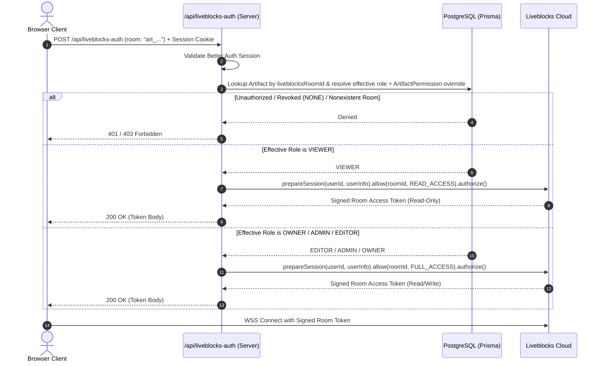

# SyncSpace — Security Model & Threat Mitigation

## 1. Security Architecture Principles

SyncSpace is engineered around a zero-trust model for client-side interactions. All authorization decisions, session validations, permission resolutions, and cryptographic signing take place exclusively on the backend. 

Key tenets:
1. **Never Trust Room IDs**: A Liveblocks room identifier is an arbitrary string; it provides zero authorization proof.
2. **Strict Multi-Tenant Isolation**: Every database query and storage lookup must be explicitly bound to the authenticated user's workspace context.
3. **Defense in Depth**: Access control is validated at the edge middleware, route handlers/server actions, application services, and external provider token endpoints.
4. **Least Privilege**: Users receive only the minimum required capabilities (e.g. read-only vs read-write scopes).

---

## 2. Authentication & Session Security

- **Session Protocol**: Standard Better Auth database session cookies marked with:
  - `HttpOnly: true` (inaccessible to malicious client scripts / XSS).
  - `Secure: true` (transmitted only over HTTPS in production).
  - `SameSite: "lax"` (mitigates Cross-Site Request Forgery).
- **Session Duration & Rotation**:
  - Max session age: 30 days.
  - Idle timeout: 7 days.
  - Periodic session token rotation on sensitive security actions (password change, email update).
- **Password Security**:
  - Hashed using `bcrypt` (cost factor 12) or `argon2id`.
  - Passwords are never returned in database queries or serialized into JWT payloads (`select: { passwordHash: false }`).
- **OAuth Providers**:
  - State parameter validation to prevent CSRF in OAuth authorization flows.
  - Verified email matching with existing local accounts.

---

## 3. Multi-Tenant Workspace Isolation & IDOR Defense

Insecure Direct Object Reference (IDOR) vulnerabilities are prevented by systematically enforcing workspace tenancy checks across all queries.

### 3.1 Tenancy Enforcement Pattern
All Prisma queries that access a project, artifact, or attachment must verify that the target entity belongs to the active `workspaceId`, and that the requesting `userId` has active membership:

```typescript
// SECURE: Strict compound filter prevents IDOR across workspaces
const artifact = await prisma.artifact.findFirst({
  where: {
    id: artifactId,
    workspace: {
      id: activeWorkspaceId,
      members: {
        some: { userId: session.user.id },
      },
    },
    isArchived: false,
  },
});

if (!artifact) {
  // Return generic 404 to avoid leaking existence of artifacts in other tenants
  throw new NotFoundError("Artifact not found");
}
```

---

## 4. Liveblocks Server-Side Authorization

Liveblocks room tokens are minted dynamically through `POST /api/liveblocks-auth` (`src/app/api/liveblocks-auth/route.ts` and `src/services/liveblocks-auth.service.ts`). Public key authentication is never used for private workspace rooms.

### 4.1 Token Issuance Workflow
1. The client `<LiveblocksProvider authEndpoint="/api/liveblocks-auth">` requests a room token when entering `<RoomProvider id={liveblocksRoomId}>`.
2. The server authenticates the request using `getServerSession()` (Better Auth session cookie) and loads the user record from PostgreSQL.
3. The server validates the requested `room` string and looks up the non-archived `Artifact` by `Artifact.liveblocksRoomId` via `AuthorizationService.requireArtifactRoomAccess(userId, roomId, "DOCUMENT")`.
4. Effective permission resolution (`AuthorizationService.requireArtifactAccess`) verifies `WorkspaceMember` membership first, then checks for an explicit per-artifact `ArtifactPermission` override (`NONE`, `VIEWER`, `EDITOR`) which constrains or elevates the workspace role (including `OWNER` and `ADMIN`):
   - Effective role `OWNER`, `ADMIN`, or `EDITOR` (when permitted by artifact policy): receives full write access:
     ```typescript
     session.allow(artifact.liveblocksRoomId, session.FULL_ACCESS); // ["*:write"]
     ```
   - Effective role `VIEWER`: receives strictly read-only access:
     ```typescript
     session.allow(artifact.liveblocksRoomId, session.READ_ACCESS); // ["*:read"]
     ```
   - Unauthenticated (`401`), malformed room (`400`), unauthorized / revoked (`NONE`) / wrong artifact type (`403`): rejected before any Liveblocks token is minted.
   - Missing or placeholder `LIVEBLOCKS_SECRET_KEY`: returns `503 Service Unavailable` (`LIVEBLOCKS_SECRET_KEY_NOT_CONFIGURED`).



---

## 5. Active Session Handling Upon Membership Revocation

When an Admin or Owner revokes a user's membership:
1. **Database Action**: The `WorkspaceMember` row is deleted inside a transaction.
2. **Web Requests**: Any subsequent HTTP request or Server Action by the revoked user fails immediately with `403 Forbidden` because `WorkspaceMember` lookup returns `null`.
3. **Live Collaboration Rooms**:
   - Liveblocks tokens are short-lived (default 5–15 minutes).
   - Once a token expires, the client must request a new token from `/api/liveblocks-auth`. Because the user is no longer a member, this request fails with `403`, immediately disconnecting the client.
   - For instant termination, SyncSpace calls the Liveblocks REST API to evict the user or purge active room connections:
     ```typescript
     await liveblocks.deleteUserConnections(userId);
     ```

---

## 6. Invitation Security & Expiration

- **Token Generation**: Generated using 256 bits of cryptographically strong pseudo-random entropy (`crypto.randomBytes(32).toString('hex')`).
- **Token Hashing at Rest**: Raw bearer tokens are **never stored** in PostgreSQL. The server computes `sha256(rawToken)` and persists the 64-character hexadecimal digest in `Invitation.token`. Lookup queries hash the incoming raw token and match on the unique index.
- **Expiration Window**: Strict 7-day expiration (`expiresAt < new Date()`). Expired invitations reject acceptance and return status `EXPIRED`.
- **Single-Use Enforcement**: When accepted, the invitation's status transitions from `PENDING` to `ACCEPTED` inside an isolated atomic database transaction (`prisma.$transaction`). Subsequent attempts are immediately rejected (`ALREADY_ACCEPTED`).
- **Email Normalization & Strict Session Matching**:
  - Invitation recipient emails are normalized using `.trim().toLowerCase()`.
  - When an authenticated user attempts to accept an invitation, the server validates:
    `user.email.trim().toLowerCase() === invitation.email.trim().toLowerCase()`
  - If the session email differs, acceptance is denied with `403 Forbidden` (`ACCOUNT_MISMATCH`). The UI prompts the user to switch accounts or sign in with the invited address.
- **Role Boundary & Ownership Protection**:
  - Invitations can **never grant OWNER status**. Attempting to invite an `OWNER` fails with `400 Bad Request`.
  - An `ADMIN` cannot invite an `OWNER` or another `ADMIN`. Only an `OWNER` can invite an `ADMIN`. Regular members (`EDITOR`, `VIEWER`) cannot invite anyone.
  - An `ADMIN` cannot promote another member to `ADMIN` or demote an `OWNER`.
  - The last remaining `OWNER` cannot be demoted or removed from a workspace (`Cannot demote/remove the only workspace owner`).
- **Acceptance Race Protection**:
  - Database-level `@@unique([workspaceId, userId])` prevents duplicate memberships.
  - Transactions re-read the invitation row and check active membership before inserting `WorkspaceMember`.

---


## 7. Secure File Attachments & Private Storage (Phase 9B)

SyncSpace enforces defense-in-depth for artifact file attachments across storage isolation, content validation, and per-request RBAC re-verification.

### 7.1 Private Storage & Fail-Closed Production Policy
- **Private Bucket / Outside Web Root**: In production (`STORAGE_PROVIDER=s3`), objects are stored in a private S3-compatible bucket with public access blocked. In local development (`STORAGE_PROVIDER=local`), objects are stored in `.storage/attachments` outside the `public/` directory.
- **Fail-Closed Production Startup**: If `NODE_ENV=production` and S3 credentials/bucket are missing, set to placeholders, or configured to use `local`/`memory`, the storage layer fails closed with `StorageConfigurationError` (`HTTP 503`).
- **Unpredictable Object Keys**: Storage keys (`workspaces/{workspaceId}/artifacts/{artifactId}/blobs/{uuid}-{hex}`) never incorporate user-supplied filenames, preventing path traversal and key guessing.

### 7.2 File Format Allowlist, Size Limit & Signature Verification
- **Maximum Size**: Strictly enforced at **10 MiB** (`10,485,760` bytes) on the server during both initiation and stored-object verification.
- **Allowlisted Formats**:
  - `application/pdf` (`.pdf` — verified `%PDF-` magic header)
  - `image/png` (`.png` — verified 8-byte PNG signature)
  - `image/jpeg` (`.jpg` / `.jpeg` — verified `FF D8 FF` JPEG SOI marker)
  - `image/webp` (`.webp` — verified `RIFF....WEBP` header)
  - `text/plain` (`.txt` — verified valid UTF-8, no null/control bytes, no active HTML/SVG/JS patterns)
  - `text/csv` (`.csv` — verified valid UTF-8, no null/control bytes, no active HTML/SVG/JS patterns; always served as `attachment`, never `inline`)
- **Active Content & Executable Rejection**: Executable binaries (Windows PE `MZ`, Linux `ELF`, Mach-O), scripts (`.js`, `.sh`, `.ps1`, `.bat`), HTML (`.html`), and SVG (`.svg`) are strictly rejected even when disguised with an allowed extension or MIME type.
- **Malware Scanning Limitation**: Built-in validation performs magic-byte signature verification, UTF-8 structural checks, and active-content pattern rejection, but **does not include an external antivirus/malware scanning engine** (such as ClamAV or cloud object scanning). Deployments handling untrusted external files should integrate asynchronous bucket malware scanning before promoting objects or restrict uploads to trusted workspace editors.

### 7.3 Permission-Aware Downloads, Previews & Two-Phase Deletion
- **Every-Request Authorization**: Listing (`GET /api/artifacts/[artifactId]/attachments`) and downloading (`GET /api/artifacts/[artifactId]/attachments/[attachmentId]/download`) call `AuthorizationService.requireArtifactAccess(userId, artifactId, "VIEW")` on every request. Explicit `NONE` overrides, archived artifacts, and revoked workspace memberships take effect immediately.
- **Safe Response Headers**: Downloads set `X-Content-Type-Options: nosniff`, `Cache-Control: private, no-store, max-age=0`, `Content-Security-Policy: default-src 'none'; ...; sandbox`, and RFC 5987 sanitized `Content-Disposition` headers.
- **Deletion Policy & Cleanup**: Only the original uploader (while retaining `EDIT` access) or a workspace `OWNER`/`ADMIN` can delete an attachment. Deletion marks the record `DELETING` before removing the storage blob so storage errors never leave an attachment downloadable or falsely report success.

---

## 8. Validation, Sanitization & Input Defense

- **Zod Schema Validation**: Every API route handler and Server Action validates incoming payloads using strict Zod schemas.
- **XSS Sanitization**:
  - Tiptap JSON output is rendered via Tiptap’s sanitized schema serializer.
  - Plain-text attachment previews are rendered as escaped text inside `<pre>` blocks and PDF previews use sandboxed `<iframe>` elements (`sandbox=""`).
- **Rate & Concurrency Limiting**:
  - Pending attachment uploads are capped per user (`MAX_PENDING_UPLOADS_PER_USER = 5`) with automatic stale-upload cleanup, and total attachments per artifact are bounded (`MAX_ATTACHMENTS_PER_ARTIFACT = 50`).
- **Audit Trail**:
  - Critical mutations (role change, member removal, artifact deletion, invite issuance, attachment upload/deletion) create an immutable row in `ActivityEvent`.
