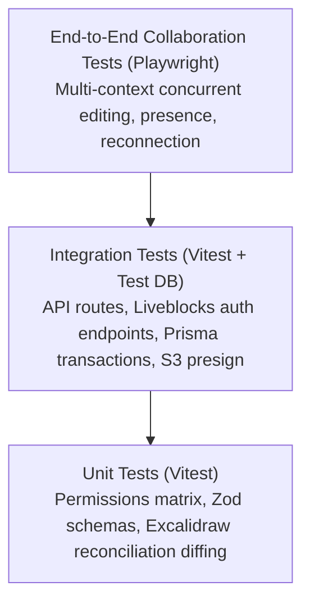

# SyncSpace — Testing Strategy & Quality Assurance Plan

## 1. Quality Assurance Philosophy

SyncSpace is a mission-critical collaborative platform where data loss, split-brain race conditions, and unauthorized document access are unacceptable. We adhere to three non-negotiable QA rules:

1. **No Fake Verifications**: A feature is not verified until exercised under realistic multi-user conditions.
2. **True Multi-Client Collaboration Testing**: Collaboration cannot be validated by opening a single browser tab. Tests must launch independent browser contexts simulating concurrent authenticated users.
3. **Strict Coverage on Security Boundaries**: All permission resolution algorithms, Liveblocks token endpoints, and IDOR tenancy queries must achieve 100% test coverage.

---

## 2. Testing Pyramid & Test Types



---

## 3. Unit Testing (Vitest)

Unit tests execute quickly in an isolated Node.js environment without network or database dependencies.

### Target Areas
- **`lib/permissions.ts`**:
  - Test `resolveEffectivePermission` under all combinations of:
    - Workspace roles: `OWNER`, `ADMIN`, `EDITOR`, `VIEWER`.
    - Artifact override permissions: `EDITOR`, `VIEWER`, `NONE`.
    - Edge cases: user not in workspace, artifact archived, invalid IDs.
- **Validation Schemas (`lib/validations/*`)**:
  - Email format, password complexity rules, workspace slug sanitation, file MIME types, and size limits.
- **Excalidraw Element Diff & Reconciliation Wrappers**:
  - Verify that version and `versionNonce` comparisons correctly identify modified elements.
  - Verify that deleted elements are reconciled with `isDeleted: true` without resurrecting previous versions.
- **Command Palette Fuzzy Search**:
  - Title and query scoring, sorting, and tag filtering algorithms.

---

## 4. Integration Testing (Vitest + PostgreSQL)

Integration tests (`tests/integration/database.test.ts`, `tests/integration/liveblocks-auth.test.ts`, and `tests/integration/invitations-and-sharing.test.ts`) exercise full route handlers, application service boundaries, and database queries against the live `syncspace-postgres` PostgreSQL 16 Docker container.

### Target Areas
- **Authentication Flows (`/api/auth/*`)**:
  - Password hashing and verification, invalid credentials rejection, session cookie issuance, and logout invalidation.
- **Invitations and Member Lifecycle (`InvitationService` & `/api/workspaces/[id]/invitations/*`)**:
  - Cryptographically secure 256-bit token generation with SHA-256 hashing at rest.
  - Expiration enforcement (7 days) and single-use atomic acceptance transactions.
  - Recipient email normalization and cross-account mismatch prevention.
  - Role escalation prevention: `ADMIN` can only invite `EDITOR` or `VIEWER`; `OWNER` cannot be invited.
  - Last-owner protection: cannot remove or demote the last remaining `OWNER`.
- **Liveblocks Server Authorization (`/api/liveblocks-auth` & `LiveblocksAuthService`)**:
  - Attempting to authorize a room as an unauthenticated user returns HTTP 401; unauthorized outsider returns HTTP 403/404.
  - Authorizing as an `OWNER`, `ADMIN`, or `EDITOR` grants `["*:write"]` (`FULL_ACCESS`).
  - Authorizing as a `VIEWER` grants `["*:read"]` (`READ_ACCESS`).
  - Per-artifact `ArtifactPermission` overrides (`EDITOR`, `VIEWER`, `NONE`) constrain or elevate workspace roles (including constraining an `ADMIN` to `VIEWER` or revoking an `EDITOR` with `NONE`).
  - Missing or placeholder `LIVEBLOCKS_SECRET_KEY` raises `LiveblocksConfigurationError` (HTTP 503).
- **Attachment Presigning (`/api/attachments/presign-upload`)**:
  - Files over 25MB are rejected with HTTP 413.
  - Disallowed MIME types (e.g. `.exe`) return HTTP 415.
  - Viewer role requesting upload URL is rejected with HTTP 403.
- **Artifact Comments, Discussions & Reactions (`CommentService` & `/api/artifacts/[id]/comments/*`)**:
  - Thread creation, replies, and ordering by timestamp against live PostgreSQL.
  - Author-only editing restrictions with `isEdited` flag tracking.
  - Cascading deletion: deleting root comment purges thread, replies, and reactions.
  - Moderator deletion: workspace `OWNER` and `ADMIN` can delete comments.
  - Reaction toggle: unique constraint idempotence preventing duplicate emoji reactions.
  - Thread resolution lifecycle: mark resolved/reopened with resolving user audit log.
  - Strict IDOR defense: non-members receive 404; explicit `NONE` overrides receive 403.
- **Workspace Member Management Transactions**:
  - Member removal immediately blocks subsequent tenant access within the same transaction.

---

## 5. End-to-End Collaboration Testing (Playwright)

End-to-End tests use Playwright to instantiate two isolated browser contexts representing separate authenticated users collaborating simultaneously in the same room.

### Multi-User Concurrency Test Harness Pattern

```typescript
import { test, expect } from "@playwright/test";

test("concurrent document editing converges deterministically", async ({ browser }) => {
  // 1. Create two isolated browser contexts with independent cookies
  const contextA = await browser.newContext({ storageState: "tests/storage/userA.json" });
  const contextB = await browser.newContext({ storageState: "tests/storage/userB.json" });

  const pageA = await contextA.newPage();
  const pageB = await contextB.newPage();

  const testDocUrl = "/acme-team/docs/spec-42";

  // 2. Open document simultaneously
  await Promise.all([
    pageA.goto(testDocUrl),
    pageB.goto(testDocUrl),
  ]);

  // Wait for Liveblocks room connection indicator
  await pageA.waitForSelector('[data-testid="room-connected"]');
  await pageB.waitForSelector('[data-testid="room-connected"]');

  // 3. User A types a heading in Paragraph 1
  await pageA.locator('.tiptap').click();
  await pageA.keyboard.type("# Architecture Overview\n");

  // 4. Verify User B observes the text within 1.5 seconds
  await expect(pageB.locator('.tiptap h1')).toHaveText("Architecture Overview", { timeout: 3000 });

  // 5. User B types a paragraph below
  await pageB.keyboard.type("This document details the real-time collaboration pipeline.\n");

  // 6. Verify User A observes User B's paragraph
  await expect(pageA.locator('.tiptap p')).toContainText("real-time collaboration pipeline", { timeout: 3000 });

  // 7. Verify presence indicator: User A sees User B's live cursor flag
  await expect(pageA.locator('[data-testid="collaborator-cursor-userB"]')).toBeVisible();

  await contextA.close();
  await contextB.close();
});
```

### Essential E2E Scenarios to Automate
1. **Concurrent Text Edits**: Two users typing in different paragraphs converge with zero loss.
2. **Concurrent Whiteboard Drawing**: User A moves a rectangle while User B draws an arrow; both shapes preserve position and properties.
3. **Viewer Lockout**: A user logged in as `VIEWER` sees the canvas in view mode; attempts to drag or delete trigger no canvas mutations and no Liveblocks mutations.
4. **Reconnection & Offline Recovery**:
   - Playwright simulates network disconnection via `page.setOffline(true)`.
   - User types text locally while offline.
   - Playwright restores network via `page.setOffline(false)`.
   - Both clients sync and converge to the updated text.
5. **Persistence After Refresh**: Reloading the page reloads the exact latest Yjs and Excalidraw content from room storage without state regression.
6. **Artifact Discussions & Reactions**: Multi-user thread creation, replies, reaction toggling, and resolve/reopen lifecycle across collaborative documents and whiteboards, with unauthenticated (401) and cross-workspace outsider (404) security rejection.

---

## 6. Continuous Integration & Quality Gates

The CI pipeline runs automatically on pull requests and commits:
1. **Lint & Formatting**: `npm run lint` and `prettier --check .`
2. **Type Checking**: `tsc --noEmit` with strict TypeScript flags enabled.
3. **Unit & Integration Suite**: `npm run test:run` with code coverage reports.
4. **Build Check**: `npm run build` validating production Next.js bundling.
5. **E2E Smoke Suite**: Headless Playwright run testing core multi-user scenarios.

### Progression Gate Criteria
A development phase cannot be considered complete until:
- 100% of unit and integration tests pass.
- No TypeScript warnings or `any` bypasses exist.
- Multi-client collaboration behavior has been demonstrated on real browser instances.
